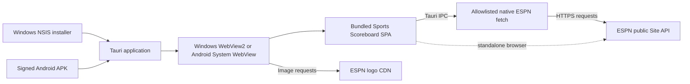

# Sports Scoreboard Native

Sports Scoreboard Native packages the [Sports Scoreboard web app](https://github.com/RyanMorrisroe/SportsScoreboard) inside native Tauri 2 applications for Windows and Android. This project owns the Tauri shell, platform packages, application identity, and release automation. The web app remains a separate project and is included here as a Git submodule.

This is a native WebView wrapper, not a rewrite of the scoreboard UI and not a hosted service. The installed app loads the built SPA from assets embedded in the application. The Tauri process includes a small command for allowlisted ESPN requests; it does not run a separate application server.

## What The App Does

The SPA provides scoreboards for College Football, NFL, MLB, NBA, and NHL, plus TV lineup, standings, game details, team details, and schedules. Users can choose favorite teams per league and customize sport-tab visibility and order. Preferences persist locally in browser storage and are not synced across browser profiles or devices. The app refreshes scoreboard data periodically and adapts its UI to desktop and mobile-sized windows.

The SPA is implemented in strict TypeScript, including its Vue application code, domain helpers, composables, Vite configuration, and tests. League-specific behavior is composed from shared defaults, sport-family defaults, and small overrides for the five supported leagues.

The standalone SPA requests ESPN's public Site API directly. In the Tauri app, ESPN JSON requests go through a constrained Rust command using a native HTTPS client; the WebView does not fetch the ESPN API directly. No ESPN API key or account is configured. An internet connection is required for live scores, team data, standings, and remote logos; availability and response formats are controlled by ESPN. The app is not affiliated with or endorsed by ESPN.



Vue 3 and Tailwind CSS are bundled locally. The production Content Security Policy allows the app's local scripts, Tauri IPC, development server connections, and ESPN-hosted logos. The native command restricts outbound JSON requests to supported ESPN API routes and caps response size and request time.

## Repository Layout

| Path                          | Responsibility                                                                                      |
| ----------------------------- | --------------------------------------------------------------------------------------------------- |
| `src-tauri/`                  | Rust startup, Tauri configuration, capability, icons, Android project, and Windows NSIS packaging.  |
| `SportsScoreboard/`           | Public SPA Git submodule. Owns the browser UI, ESPN requests, normalization, and static-site build. |
| `scripts/`                    | Wrapper release-version helpers used by GitHub Actions.                                             |
| `.github/workflows/build.yml` | Windows and Android PR builds and SPA-release-driven platform releases.                             |

The Tauri process registers one application-specific command for allowlisted ESPN JSON requests. Its `main` window has only Tauri's `core:default` capability; it does not grant filesystem or shell access. Debug builds enable Tauri logging; release builds do not.

## Windows Distribution

The configured distribution target is a 64-bit Windows NSIS setup executable. The installer defaults to a per-user installation and refuses to downgrade an installed version. Tauri's default WebView2 bootstrapper mode may download the WebView2 runtime when it is missing. The app needs internet access for ESPN API data and remote team logos.

The installer is currently unsigned. Windows SmartScreen may display an unrecognized-publisher warning. No in-app updater is configured; install a newer release manually.

## Android Distribution

The Android target requires API 36 or newer. SPA release builds produce an ARM64 APK signed with the project's persistent private sideloading key and attach it to the matching GitHub release. This is not a Play Store release and the signing key used in github builds is kept private; Android requires APKs to be signed, and the stable key allows users to install later releases over the existing app.

## Development Requirements

- Windows with the Visual Studio C++ build tools and the WebView2 runtime.
- Node.js 20 or newer and npm.
- Rust 1.90 or newer with the MSVC Windows target.
- Git with submodule support.
- Android Studio with Android SDK Platform 37, Build Tools 37.0.0, NDK 30.0.16248370, and the Android Rust target for Android development/builds.
- Java 21 or newer for Android Gradle builds.

Strongly recommend following the Tauri setup docs at https://v2.tauri.app/start/prerequisites/

Clone the wrapper and its pinned SPA revision, then install both projects' dependencies:

```powershell
git clone --recurse-submodules https://github.com/RyanMorrisroe/SportsScoreboard-Native.git
cd SportsScoreboard-Native
npm ci
npm ci --prefix SportsScoreboard
```

If the submodule directory is empty after checkout, initialize it explicitly:

```powershell
git submodule update --init --recursive
npm ci --prefix SportsScoreboard
```

Run the desktop app in development mode:

```powershell
npm run dev
```

Tauri starts the SPA's Vite development server on `http://localhost:8000` and opens the WebView. Use the built-in Tauri CLI information command to inspect the local toolchain:

```powershell
npm run check
```

For SPA-only checks, run the commands from `SportsScoreboard/`:

```powershell
npm run typecheck
npm test
npm run test:coverage
```

`npm test` and `npm run test:coverage` include the live ESPN smoke test and require network access; `npm run typecheck` does not. Run only deterministic unit and fixture-backed integration tests with `npx vitest run tests/unit tests/integration`. To run the Vite server without launching Tauri, use `npm run serve` from `SportsScoreboard/`; it stays in the foreground on port 8000, and `Ctrl+C` stops it. The port is configured as strict, so stop any existing listener on 8000 before starting another instance.

Create a production build and NSIS installer locally:

```powershell
npm run build
```

Before packaging, `npm run build` runs the Rust unit tests. The Tauri build hook then runs `npm run build` inside `SportsScoreboard/`, generating the ignored `SportsScoreboard/dist/` directory and running the SPA project's existing checks before Tauri embeds it. The installer is written under `src-tauri/target/release/bundle/nsis/`.

The generated Android project is kept under `src-tauri/gen/android/`. Run Android development on a connected device or emulator with:

```powershell
npm run android:dev
```

Build an unsigned ARM64 APK locally with:

```powershell
npm run android:build -- --apk --target aarch64 --ci
```

The APK is written under `src-tauri/gen/android/app/build/outputs/apk/`. Local builds remain unsigned unless `src-tauri/gen/android/keystore.properties` is present; this file is ignored by Git.

The Rust tests cover the native ESPN URL allowlist, redirects, response limits, and error handling. The SPA maintains its own test suite for browser behavior and scoreboard domain logic.

## Versioning And Releases

The wrapper version is `0.1.0` in both the root `package.json` and `src-tauri/Cargo.toml`; keep these values synchronized when changing the wrapper version. The published app version combines the stable SPA release version with the wrapper version. For example, SPA release `v1.3.0` and wrapper version `0.1.0` produce app version `1.3.0-wrapper.0.1.0` and wrapper release tag `v1.3.0-wrapper.0.1.0`. CI temporarily applies that composite version to the Rust package and Tauri build config; it also uses the workflow run number as Android's monotonically increasing `versionCode`. These generated overrides are not committed.

Wrapper pull requests run Windows and Android builds but do not publish. A published stable SPA release with a `vMAJOR.MINOR.PATCH` tag triggers the cross-repository dispatch, builds the exact released SPA tag and commit, then publishes the NSIS installer and signed ARM64 APK in this repository. SPA branch pushes do not trigger wrapper releases. Duplicate release dispatches are ignored when the composite wrapper release already exists.

To release wrapper-only changes, increment the version in both the root `package.json` and `src-tauri/Cargo.toml`, then refresh `src-tauri/Cargo.lock` with a Cargo build. The new wrapper version is included the next time the SPA publishes a release; wrapper commits and tags do not independently publish installers.

## Configuration

The product name is `SportsScoreboard`, and its Tauri identifier is `com.ryan.sportsscoreboard`. The Windows startup window is centered at 1280 x 800 logical pixels and can be resized down to 900 x 640; Android uses a full-screen mobile WebView and requires API 36 or newer. The production CSP permits local scripts, Tauri IPC, Vite development connections, and ESPN-hosted logos; the native command performs ESPN API requests outside the WebView.

The bundle metadata and license are defined in `src-tauri/tauri.conf.json` and the Rust manifest. The root `LICENSE` applies to this wrapper; the SPA remains a separate repository with its own project metadata and license.
