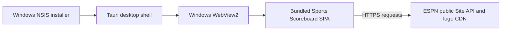

# Sports Scoreboard Desktop

Sports Scoreboard Desktop is a Windows desktop application that packages the [Sports Scoreboard web app](https://github.com/RyanMorrisroe/SportsScoreboard) inside a native Tauri 2 window. The desktop project owns the Tauri shell, Windows installer, application identity, and release automation. The web app remains a separate project and is included here as a Git submodule.

This is a native WebView wrapper, not a rewrite of the scoreboard UI and not a hosted service. The installed app loads the built SPA from assets embedded in the application. There is no application server or backend.

## What The App Does

The SPA provides scoreboards for College Football, NFL, MLB, NBA, and NHL, plus TV lineup, standings, game details, team details, schedules, and favorite-team highlighting. It refreshes scoreboard data periodically and adapts its browser UI to desktop and mobile-sized windows.

The browser requests ESPN's public Site API directly. No ESPN API key or account is configured by this wrapper. An internet connection is required for live scores, team data, standings, and remote logos; availability and response formats are controlled by ESPN. The app is not affiliated with or endorsed by ESPN.



The frontend currently loads Vue 3 from `unpkg.com` and Tailwind's browser package from `cdn.jsdelivr.net`; those scripts, ESPN API requests, and ESPN-hosted logos are allowed by the production Content Security Policy. The app therefore needs network access to those hosts as well as the ESPN endpoints.

## Repository Layout

| Path                          | Responsibility                                                                                      |
| ----------------------------- | --------------------------------------------------------------------------------------------------- |
| `src-tauri/`                  | Rust startup, Tauri configuration, capability, icons, and Windows NSIS packaging.                   |
| `SportsScoreboard/`           | Public SPA Git submodule. Owns the browser UI, ESPN requests, normalization, and static-site build. |
| `scripts/`                    | Wrapper release-version helpers used by GitHub Actions.                                             |
| `.github/workflows/build.yml` | Wrapper PR build and SPA-release-driven Windows release.                                            |

The Tauri process registers no application-specific native commands. Its `main` window has only Tauri's `core:default` capability; it does not grant filesystem or shell access. Debug builds enable Tauri logging; release builds do not.

## Windows Distribution

The configured distribution target is a 64-bit Windows NSIS setup executable. The installer defaults to a per-user installation and refuses to downgrade an installed version. Tauri's default WebView2 bootstrapper mode may download the WebView2 runtime when it is missing. The app itself also needs internet access to load its CDN scripts and query ESPN.

The installer is currently unsigned. Windows SmartScreen may display an unrecognized-publisher warning. No in-app updater is configured; install a newer release manually.

## Development Requirements

- Windows with the Visual Studio C++ build tools and the WebView2 runtime.
- Node.js 20 or newer and npm.
- Rust 1.90 or newer with the MSVC Windows target.
- Python 3 for the SPA's local HTTP development server.
- Git with submodule support.

Clone the wrapper and its pinned SPA revision, then install both projects' dependencies:

```powershell
git clone --recurse-submodules https://github.com/RyanMorrisroe/SportsScoreboard-Native.git
cd SportsScoreboard-Native
npm ci
npm ci --prefix SportsScoreboard
```

If the submodule directory is empty after checkout, initialize it explicitly:

```powershell
git submodule update --init --recursive
npm ci --prefix SportsScoreboard
```

Run the desktop app in development mode:

```powershell
npm run dev
```

Tauri starts the SPA's Python server on `http://localhost:8000` and opens the WebView. Use the built-in Tauri CLI information command to inspect the local toolchain:

```powershell
npm run check
```

Create a production build and NSIS installer locally:

```powershell
npm run build
```

The Tauri build hook runs `npm run build` inside `SportsScoreboard/`. That generates the ignored `SportsScoreboard/dist/` directory and runs the SPA project's existing build checks before Tauri embeds it. The installer is written under `src-tauri/target/release/bundle/nsis/`.

This wrapper adds no unit-test suite because it contains no scoreboard domain logic. The SPA's existing checks remain part of its own build.

## Versioning And Releases

The wrapper version is `0.1.0` in both the root `package.json` and `src-tauri/Cargo.toml`; keep these values synchronized when changing the wrapper version. The published desktop app version combines the stable SPA release version with the wrapper version. For example, SPA release `v1.3.0` and wrapper version `0.1.0` produce desktop version `1.3.0-wrapper.0.1.0` and wrapper release tag `v1.3.0-wrapper.0.1.0`. CI temporarily applies that composite version to the Rust package and Tauri build config; it does not commit the generated override.

Wrapper pull requests run a Windows build but do not publish. A published stable SPA release with a `vMAJOR.MINOR.PATCH` tag triggers the cross-repository dispatch, builds the exact released SPA tag and commit, then publishes the NSIS installer in this repository. SPA branch pushes do not trigger wrapper releases. Duplicate release dispatches are ignored when the composite wrapper release already exists.

To release wrapper-only changes, increment the version in both the root `package.json` and `src-tauri/Cargo.toml`, then refresh `src-tauri/Cargo.lock` with a Cargo build. The new wrapper version is included the next time the SPA publishes a release; wrapper commits and tags do not independently publish installers.

### Dispatch Credential Setup

The SPA release workflow uses a GitHub App installation token to dispatch into this repository. Configure the app for the `RyanMorrisroe` account with `Contents: write` permission and install it with access to the `SportsScoreboard-Native` repository only. In the SPA repository's **Settings > Secrets and variables > Actions**, add:

- `NATIVE_WRAPPER_APP_CLIENT_ID`: the GitHub App client ID.
- `NATIVE_WRAPPER_APP_PRIVATE_KEY`: the GitHub App private key PEM.

The token is scoped to the wrapper repository and only the contents permission is requested. The wrapper release workflow uses its own `GITHUB_TOKEN` with `contents: write` only in the publishing job.

## Configuration

The product name is `SportsScoreboard`, and its Tauri identifier is `com.ryan.sportsscoreboard`. The startup window is centered at 1280 x 800 logical pixels and can be resized down to 900 x 640. The production CSP permits the frontend's verified CDN and ESPN hosts; update it only when the SPA's actual network requirements change.

The bundle metadata and license are defined in `src-tauri/tauri.conf.json` and the Rust manifest. The root `LICENSE` applies to this wrapper; the SPA remains a separate repository with its own project metadata and license.
